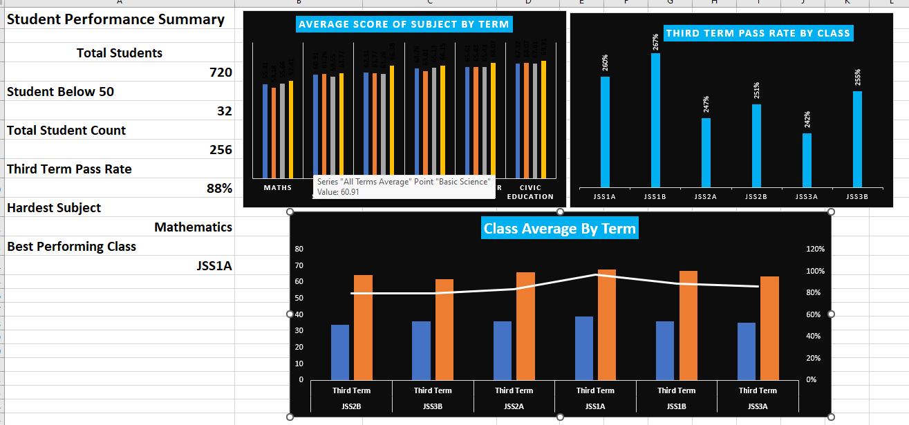

# Greenfield School Results Project (Excel)

## Project Overview

This project involved analysing students' academic performance using Microsoft Excel. The analysis covered data cleaning, duplicate removal, student performance tracking, subject averages, class comparisons, pass rates, and improvement across academic terms. A summary dashboard was developed to highlight key performance indicators, identify the hardest subject, recognise the best-performing class, and identify students requiring additional academic support. The findings provide useful insights to support informed decision-making and improve teaching and learning outcomes.

---
## Project Questions Answered
 The principal wants answers to 4 questions: 
- ✓ Which class is doing best, and which class needs the most help? 
- ✓ Which subject is the hardest for students? 
- ✓ Are students improving from First Term to Third Term? 
- ✓ Which students need extra support?

  ---
  ## Project Tools
  - Microsoft Excel
  - Power Query
  - Charts
  - Sheets & Tables

    ---
    ## Project Content
    - Cleaned Sheet
    - Top 10 Sheet
    - Top 3 Sheet
    - Class Summary Sheet
    - Improvement Sheet
    - Subject Sheet
    - Summary Sheet
   
      ---
      ## Summary Preview
      

      ---
      ## KPIs
      - Total Unique Students          256
      - Third Term Pass Rate            88%
      - Students Scoring Below 50 Average       32
      - Hardest Subject Across Terms                Mathematics
      - Best Performing Class in Third Term             JSS1A
     
        ---
        ## Message to The Principal
           The analysis shows that 32 students scored below 50 and require additional academic support. Mathematics recorded the lowest             average score and should receive special attention through extra lessons and targeted teaching. JSS1A recorded the highest                Third Term class average, while the overall Third Term pass rate was 88%. Before making major decisions, I recommend reviewing            individual student performance and attendance records to understand the factors affecting academic achievement.

        ---
        ## Conclusion
         This project provided practical insight into how data analysis can transform raw academic records into meaningful information.           Through data cleaning, calculations, and visualizations, the exercise demonstrated the importance of accurate record-keeping and          data-driven evaluation in education. Overall, the project strengthened my Excel skills and showed how data can be used to monitor         progress, identify patterns, and support better educational outcomes.
